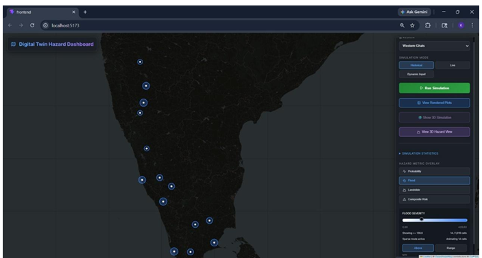
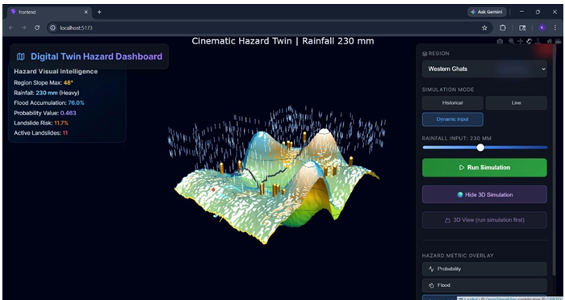
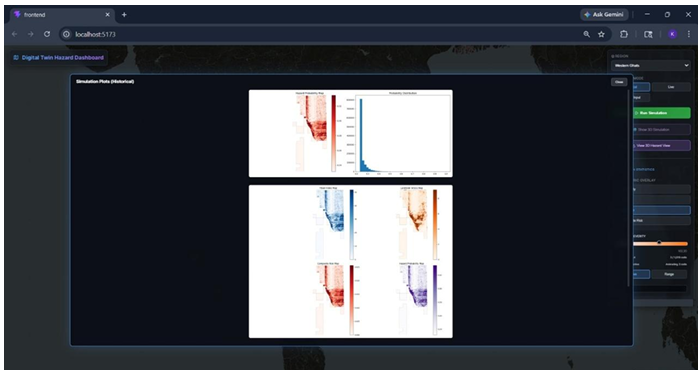

# Multi-Hazard Prediction System

A physics-informed digital twin for exploring flood, landslide, and combined
hazard risk across Uttarakhand, Assam, and the Western Ghats.


## Table of contents

1. [Overview](#1-overview)
2. [Problem Statement](#2-problem-statement)
3. [Objectives](#3-objectives)
4. [Key Features](#4-key-features)
5. [Screenshots & Demo](#5-screenshots--demo)
6. [System Architecture](#6-system-architecture)
7. [Technology Stack](#7-technology-stack)
8. [Project Structure](#8-project-structure)
9. [Installation & Setup](#9-installation--setup)
10. [Environment Configuration](#10-environment-configuration)
11. [Running the Application](#11-running-the-application)
12. [API Documentation](#12-api-documentation)
13. [Dataset & Data Sources](#13-dataset--data-sources)
14. [Methodology & Implementation](#14-methodology--implementation)
15. [Results & Evaluation](#15-results--evaluation)
16. [Limitations](#16-limitations)
17. [Future Scope](#17-future-scope)
18. [Contributing](#18-contributing)
19. [License](#19-license)
20. [Authors & Acknowledgements](#20-authors--acknowledgements)

## 1. Overview

The Multi-Hazard Prediction System combines terrain processing, hydrology
approximations, rainfall inputs, and a trained XGBoost model into an
interactive web dashboard. It divides each supported region into analysis
cells and estimates:

- flood intensity and probability;
- landslide stress;
- composite and hybrid risk;
- rainfall-dependent changes in risk; and
- locations that may need closer inspection through adaptive refinement.

The application presents these results as an interactive Leaflet map,
Plotly charts, and a generated 3D terrain/hazard view.

This is an experimental analysis and scenario-exploration tool. It is not an
official warning service and must not be used as the sole basis for emergency
response, evacuation, construction, or public-safety decisions.

## 2. Problem Statement

Floods and landslides are influenced by interacting variables rather than one
measurement. Rainfall intensity, accumulated water, elevation, terrain slope,
soil saturation, flow accumulation, and historical hazard patterns can all
vary across a small geographic area.

Single-factor maps may hide these interactions and usually provide limited
support for what-if analysis. This project addresses that problem by combining
terrain and hydrology calculations with rainfall scenarios and machine-learning
enrichment in one interactive digital-twin workflow.

The system helps users explore where risk indicators may increase, compare
rainfall assumptions, and inspect the physical features behind a score. It
does not replace official forecasts or emergency-management systems.

## 3. Objectives

1. Build a reusable digital representation of selected Indian regions.
2. Convert DEM and rainfall data into grid-cell-level hazard indicators.
3. Model water memory, flow accumulation, saturation, flood intensity, and
   landslide stress.
4. Combine interpretable physics-based outputs with historical-event ML
   predictions.
5. Support historical, live, and fast dynamic rainfall scenarios.
6. Deliver results through a browser dashboard, compact GeoJSON, charts, and
   3D terrain visualization.
7. Cache expensive terrain and simulation results for repeated exploration.

## 4. Key Features

- Terrain-aware flood, landslide, and composite-risk calculations.
- DEM reprojection to UTM coordinates for distance and area calculations.
- Grid-cell generation, slope/elevation extraction, downhill graphs, and flow
  accumulation.
- Soil-memory and saturation updates across simulation steps.
- XGBoost-based risk enrichment using historical event and rainfall features.
- Historical, live-rainfall, and dynamic what-if modes.
- Adaptive refinement of high-risk cells.
- Compact GeoJSON responses for browser visualization.
- Probability histograms, multi-hazard plots, rainfall-scenario plots,
  statistics, and progress reporting.
- Cached terrain and GeoJSON artifacts to avoid repeating expensive work.

Supported regions are `uttarakhand`, `assam`, and `western_ghats`. Supported
modes are `historical`, `live`, and `dynamic`.

## 5. Screenshots & Demo

### Hazard map



### 3D hazard simulation



### Simulation plots



To run the demo locally, start the backend and frontend as described in
[Running the Application](#11-running-the-application). The dashboard normally
runs at `http://localhost:5173`, while the API runs at
`http://localhost:8345`.

## 6. System Architecture

```text
                         +-----------------------------+
                         | React + Vite dashboard      |
                         | Leaflet + Plotly + 3D view  |
                         +--------------+--------------+
                                        |
                              HTTP JSON / GeoJSON
                                        |
                         +--------------v--------------+
                         | FastAPI / Uvicorn           |
                         | server.py :8345            |
                         +------+----------------------+
                                |
              +-----------------+-----------------+
              |                                   |
  +-----------v-----------+           +-----------v-----------+
  | Simulation engine     |           | Output/static files   |
  | main.py               |           | outputs/              |
  +-----------+-----------+           +-----------------------+
              |
     +--------+---------+------------------+
     |                  |                  |
 +---v---+          +---v---+          +---v---+
 | core/ |          |services/|        |ml_models/|
 | DEM,  |          |rainfall,|        |XGBoost   |
 | grid, |          |hazards, |        |artifact  |
 | flow  |          |state    |        +---------+
 +---+---+          +----+----+
     |                   |
     +---------+---------+
               |
        data/ DEM, rainfall,
        and historical events
```

The backend validates simulation requests, launches the engine when needed,
serves generated files, clips output to regional boundaries, compacts GeoJSON,
and reports progress. The frontend consumes those resources and renders map,
chart, and 3D views.

## 7. Technology Stack

| Layer | Technologies | Responsibility |
| --- | --- | --- |
| Frontend | React, Vite, React Leaflet, Leaflet | Dashboard and interactive map |
| Charts/3D | Plotly, `react-plotly.js`, Lucide React | Charts, terrain view, icons |
| API | Python, FastAPI, Uvicorn, Pydantic | REST API and static files |
| Scientific | NumPy, pandas, SciPy, xarray | Arrays, tables, rainfall processing |
| Geospatial | GeoPandas, Shapely, Rasterio, pyproj | DEMs, geometry, reprojection |
| Hydrology | NetworkX, pysheds | Downhill graphs and flow calculations |
| ML | XGBoost, scikit-learn | Risk enrichment and evaluation |
| Data formats | GeoTIFF, NetCDF, NumPy, CSV, GeoJSON | Inputs, models, and outputs |

## 8. Project Structure

```text
.
├── core/                 Terrain, grid, graph, and hydrology calculations
├── services/             Rainfall, hazard, state, and refinement services
├── data/                 DEMs, rainfall files, and event data
├── ml_models/            Trained model and feature metadata
├── outputs/              Generated GeoJSON, plots, stats, and caches
├── frontend/             React/Vite dashboard
├── main.py               Simulation-engine CLI entry point
├── server.py             FastAPI application
├── train_ml_model.py     ML training workflow
├── ML_TRAINING_CONDITIONS.md
├── ML_TRAINING_RESULTS.md
├── PROJECT_EXPLANATION.txt
└── TECHNICAL_SPECIFICATION_DEEP_DIVE.txt
```

Important modules include `core/grid.py`, `core/terrain.py`,
`core/hydrology.py`, `services/hazard_service.py`,
`services/rainfall_service.py`, `main.py`, and `server.py`.

## 9. Installation & Setup

### Prerequisites

- Windows, macOS, or Linux.
- Python 3.10 or newer.
- Node.js 18 or newer and npm.
- The repository's DEM, rainfall, event, and model files.
- Adequate disk space for raster processing and generated GeoJSON.

The repository does not currently contain a `requirements.txt`; install the
Python dependencies used by the source modules:

```powershell
py -3.10 -m venv venv
.\venv\Scripts\Activate.ps1
python -m pip install --upgrade pip
python -m pip install fastapi "uvicorn[standard]" numpy matplotlib geopandas rasterio tqdm xgboost scikit-learn pandas shapely requests urllib3 xarray scipy pyproj networkx pysheds
```

If PowerShell activation is unavailable, use the interpreter directly:

```powershell
.\venv\Scripts\python.exe -m pip install fastapi "uvicorn[standard]" numpy matplotlib geopandas rasterio tqdm xgboost scikit-learn pandas shapely requests urllib3 xarray scipy pyproj networkx pysheds
```

Install the frontend dependencies:

```powershell
Set-Location frontend
npm install
```

Available frontend scripts:

```text
npm run dev       Start Vite development server
npm run build     Create production build
npm run preview   Preview production build
npm run lint      Run ESLint
```

## 10. Environment Configuration

The frontend currently uses `http://localhost:8345` as its backend origin,
defined in `frontend/src/App.jsx`. If the API host or port changes, update
that value before starting the frontend.

The backend selects the interpreter used to launch `main.py` in this order:

1. `DIGITALTWINS_PYTHON`, if it points to an existing interpreter;
2. `venv\Scripts\python.exe` in the repository; or
3. the current Python interpreter.

PowerShell example:

```powershell
$env:DIGITALTWINS_PYTHON = "C:\path\to\python.exe"
```

Region input paths are configured in `main.py` under `REGION_CONFIG`. There
is currently no committed `.env.example`; never commit credentials, tokens,
or local machine paths.

## 11. Running the Application

Use two terminals from the repository root.

### Terminal 1: start the API

```powershell
.\venv\Scripts\python.exe server.py
```

The API listens on `http://localhost:8345`. Interactive documentation is
available at `http://localhost:8345/docs`.

### Terminal 2: start the dashboard

```powershell
Set-Location frontend
npm run dev
```

Open the URL printed by Vite, normally `http://localhost:5173`.

### First-run order

Run historical mode for a region before dynamic mode. Historical mode creates
the base GeoJSON and terrain artifacts that fast dynamic mode can reuse.
Historical processing may be slow on a cold cache.

## 12. API Documentation

All API paths are served from `http://localhost:8345`.

### `GET /api/progress`

Returns the latest progress from `outputs/progress.json`:

```json
{
  "progress": 100,
  "status": "Historical simulation complete"
}
```

### `POST /api/simulate`

Request:

```json
{
  "region": "assam",
  "mode": "dynamic",
  "rainfall": 250
}
```

`region` must be `uttarakhand`, `assam`, or `western_ghats`. `mode` must be
`historical`, `live`, or `dynamic`. Rainfall defaults to `100.0`.

```powershell
curl.exe -X POST http://localhost:8345/api/simulate `
  -H "Content-Type: application/json" `
  -d '{\"region\":\"assam\",\"mode\":\"dynamic\",\"rainfall\":250}'
```

The response contains status, message, output GeoJSON path, optional plot
paths, logs, and—when using the fast dynamic path—inline compact GeoJSON.

### `POST /api/generate-plots`

Runs a simulation with plot generation enabled:

```powershell
curl.exe -X POST http://localhost:8345/api/generate-plots `
  -H "Content-Type: application/json" `
  -d '{\"region\":\"uttarakhand\",\"mode\":\"historical\",\"rainfall\":100}'
```

Generated plots include probability histograms, multi-hazard comparisons, and
rainfall-scenario charts.

### `GET /api/geojson`

Retrieves processed map data:

```text
/api/geojson?region=assam&mode=historical&include_ml=true&compact=true
```

Query parameters are `region`, `mode`, `include_ml` (default `true`), and
`compact` (default `true`).

### `GET /outputs/<filename>`

Serves generated files such as:

```text
/outputs/assam_historical_summary.geojson
/outputs/assam_historical_multi_hazard.png
/outputs/progress.json
```

## 13. Dataset & Data Sources

The project uses:

- DEM GeoTIFFs for Uttarakhand, Assam, and the Western Ghats;
- projected UTM DEMs and flow-accumulation NumPy arrays;
- CHIRPS rainfall NetCDF files;
- `data/finalss_india_flood_landslide.csv` historical events;
- `ml_models/ml_risk_model.pkl` and related feature metadata; and
- generated GeoJSON, PNG, JSON, and cache files.

Expected input paths include:

```text
data/3dem/assam_small.tif
data/3dem/uttarakhand_dem_small.tif
data/3dem/western_ghats_dem.tif
data/dem/*_utm_small.tif
data/dem/*_flow.npy
data/rainfall/chirps-v2.0.<year>.days_p05.nc
data/finalss_india_flood_landslide.csv
```

Source datasets may have separate licenses and redistribution restrictions.
Review the original provider terms before publishing or sharing them.
Large DEMs, arrays, caches, generated outputs, and the `data/` directory are
ignored by `.gitignore`.

## 14. Methodology & Implementation

### Terrain and hydrology

1. Load a region DEM and projected UTM raster.
2. Generate a base analysis grid.
3. Calculate elevation and slope statistics.
4. Build a downhill graph for downstream movement.
5. Calculate flow accumulation and upstream relationships.
6. Refine high-risk cells when the adaptive refinement threshold is met.

### Physics-based simulation

Rainfall increases each cell's water memory, while a decay factor represents
drainage or drying. Memory, upstream contribution, slope, and flow produce a
flood index, saturation value, landslide stress, and composite physics risk.

### Machine-learning enrichment

`services/hazard_service.py` loads the XGBoost artifact when ML enrichment is
requested. Output properties can include `ml_risk_score`,
`physics_risk_score`, and `hybrid_risk_score`.

### Dynamic mode

Dynamic mode applies a rainfall amount to cached base GeoJSON rather than
rerunning the full simulation for every input. Rainfall is bounded to
`0`–`500` mm. Zero rainfall clears hazard values; higher rainfall can activate
more cells by lowering the activation threshold.

## 15. Results & Evaluation

The recorded ML training summary reports approximately:

| Metric | Documented range | Meaning |
| --- | --- | --- |
| ROC-AUC | 0.80–0.90 | Discrimination between positive and negative samples |
| PR-AUC | 0.70–0.85 | Precision-recall behavior for imbalanced data |
| F1-score | 0.70–0.85 | Balance between precision and recall |

These are training-workflow results, not a guarantee of operational accuracy.
The documented results identify a small positive event set, sparse Western
Ghats coverage, and rainfall dominance in some model outputs.

See [`ML_TRAINING_RESULTS.md`](./ML_TRAINING_RESULTS.md) and
[`ML_TRAINING_CONDITIONS.md`](./ML_TRAINING_CONDITIONS.md) for the complete
training data, features, hyperparameters, and evaluation notes.

## 16. Limitations

- The model is an experimental hybrid of simplified physical indicators and
  historical-data-driven ML.
- Historical event coverage is limited and the positive sample count is small.
- Western Ghats labels are sparse or unavailable in the documented workflow.
- DEM resolution, rainfall coverage, event geocoding, and matching tolerance
  affect results.
- Live mode depends on network access and rainfall-service availability.
- Dynamic mode is a fast adjustment of cached data, not a complete simulation
  rerun for every slider value.
- A high score identifies a cell for investigation; it does not prove that a
  flood or landslide will occur.

Validate results against local observations, authoritative forecasts, and
qualified disaster-management experts before making real-world decisions.

## 17. Future Scope

- Expand and validate historical event labels.
- Add higher-resolution elevation, slope, aspect, soil, and drainage features.
- Add rainfall anomalies and longer climatological baselines.
- Train region-specific and hazard-specific models.
- Quantify uncertainty and display confidence intervals.
- Validate predictions against independent held-out events.
- Integrate official real-time rainfall and alert sources.
- Add automated API and simulation-invariant tests.
- Package the backend and frontend for reproducible deployment.

## 18. Contributing

1. Create a focused feature branch.
2. Preserve existing region and mode behavior unless the change is intended.
3. Update related documentation and tests.
4. Run `npm run lint`, `npm run build`, and backend syntax checks.
5. Describe data, model, API, or UX changes in the pull request.

For training changes, include dataset scope, matching assumptions, metrics,
and known limitations. Do not commit credentials, virtual environments, large
datasets, or generated outputs.

## 19. License

This repository does not currently include a `LICENSE` file. Until an explicit
license is added, all rights remain with the copyright holder and reuse or
redistribution should be treated as restricted.

## 20. Authors & Acknowledgements

### Authors

The repository does not currently contain a formal author list. Add verified
contributors and ownership details here when they are confirmed.

### Acknowledgements

This project uses open-source technologies including React, Vite, FastAPI,
Uvicorn, GeoPandas, Rasterio, Shapely, NumPy, pandas, xarray, XGBoost,
scikit-learn, Leaflet, Plotly, NetworkX, and pysheds. Data providers and
original dataset authors should be credited according to their respective
licenses and citation requirements.

## Troubleshooting

### `ModuleNotFoundError`

Confirm that the project interpreter is being used:

```powershell
.\venv\Scripts\python.exe -c "import fastapi, geopandas, rasterio, xarray; print('imports ok')"
```

Install missing packages into that same environment.

### Dynamic mode has no base GeoJSON

Run historical mode for the same region first:

```powershell
.\venv\Scripts\python.exe main.py --region assam --mode historical --skip_plots 1
```

### Dashboard has no map data

Confirm that `server.py` is running on port `8345`, `/docs` opens, the
selected output exists under `outputs/`, and the frontend backend origin
matches the API URL.

## Development

```powershell
Set-Location frontend
npm run lint
npm run build

Set-Location ..
.\venv\Scripts\python.exe -m compileall core services main.py server.py train_ml_model.py
```

When changing simulation behavior, validate at least one historical region and
one dynamic rainfall scenario. When changing API responses, verify
`/api/progress`, `/api/simulate`, `/api/geojson`, and `/docs`.
